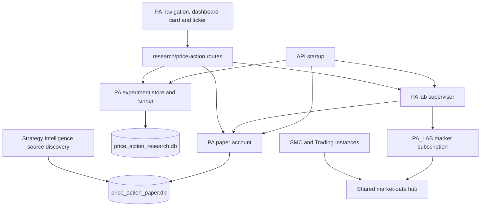

# Price Action Lab retirement

Status: code implementation prepared; target audit, staging rollout, backups
and cleanup remain pending. No VPS data has been deleted.

## Dependency map before destructive changes

| Component | Existing resource use | Disabled behavior |
|---|---|---|
| webhook_api.py | Import-time PA account/broker/journal connections, supervisor, subscription, experiment store | Construct none of these objects |
| price_action_lab.py | price-action-paper-runtime supervisor, PA_LAB subscription, in-memory candidate shadow runs | No API-created runtime or subscription |
| price_action_research.py | Separate experiment/artifact SQLite store and synchronous research requests | No store/runner construction |
| research/price-action routes and api/v1 aliases | Charts/replay, sessions, paper orders, journal, shadow candidates, research/artifact routes | Lightweight HTTP 410; acceptance policy may reject first with 423 |
| ActiveDecisionSources | SI discovery and paper evidence readers open the PA database | Do not bind a PA source; retain SMC and instance sources |
| Dashboard | PA page/nav, card and ticker polling every four seconds | No PA page/card/nav/poller; old bookmark redirects to dashboard |
| Factory reset/shutdown | Assume PA objects exist | Skip absent objects without creating new stores |
| Dedicated CLI jobs | Feed validator and reference-study runner create PA stores/feeds | Exit disabled before data creation |
| Nightly backup | Copies every SQLite database | Skip current retired PA files; retain old PA financial backups |
| Containers/schedulers | No PA-only container, reservation or scheduler found in tracked definitions | Actual VPS processes and host schedules still require audit |

PA-owned bindings are HUB_PRICE_ACTION_PAPER_DB and
HUB_PRICE_ACTION_RESEARCH_DB. The paper file contains the isolated PA broker
v2_* financial tables, pa_* sessions/activity/evaluations/candidates/order and
funding metadata, governance journal, and active evidence receipts. The research
file contains pa_experiments and pa_research_artifacts. A name alone does not
prove exclusive ownership: verify actual resolved paths, schema, account type,
volume consumers, file ownership, hardlinks and open descriptors on the VPS.

Preserve shared native_price_action strategy code, its Trading Instance adapter,
PaperBrokerV2 implementation, market hub/stream/candle cache, lab lifecycle
helpers, SMC, shared account/journal/ledger, SI/PG research stores and existing
comparison/evidence artifacts. Never delete shared SI rows that reference a
retired historical source or manufacture replacement history.

## Configuration and staged rollout

PRICE_ACTION_LAB_ENABLED=false is the default and is explicit in production
compose.yaml and the staging API profile. True is an explicit compatibility or
rollback setting, not a default. Frontend PA entry points are retired.

Build, test and scan the exact changed source. Roll out the existing staging
API first while preserving workspace, volumes, authentication, TLS, credential
bindings, worker/overlay, rollback image and the 1536 MiB memory/swap limits.
Check startup/restart with both PA files absent, authenticated routes, no PA
database opens/threads/subscriptions, SMC and SI behavior, and browser network
traffic. Roll out only the production application after staging verification.
Shared modules can remain loaded for active features; they are not dedicated
PA runtime objects.

The read-only ops/audit-price-action-retirement.py reports actual configured
paths, table/index/trigger names, UID/GID, sizes, sidecars, volume consumers, open
PA file descriptors and Docker CPU/RAM/BlockIO samples for both APIs. It cannot
delete data or change services. Unreadable FD directories remain explicit;
zero observed descriptors with incomplete coverage is not proof of absence.
Docker resource samples are whole-container figures, not PA-attributed metrics.

## Staging cleanup prerequisites

The latest target evidence reports 20,395,585,536 free bytes and a
9,580,040,192-byte shortfall for the existing raw-snapshot recovery method.
Do not delete original data merely to bypass this backup capacity bound.

Before cleanup: deploy and verify the disabled API; establish exclusive
ownership and no consumers; capture a consistent verified backup including
committed WAL contents and original financial rows; complete required recovery
checks. Only exact staging PA-owned database paths and validated SQLite sidecars
are candidates. Preserve shared financial stores and financial backup archives.
Do not unlink a live database or use wildcards/volume pruning. Measure actual
filesystem free bytes before and after; the former 17.1 GB size is not a measured
recovery result.

## Production deletion plan and approval

Production data deletion is NOT authorized. The production plan must list exact
container/image IDs, volume names, resolved paths, SQLite schema objects,
dependencies, backup/restore receipts and expected byte counts from the actual
VPS audit. Request approval of that concrete plan before destructive execution.
Production PA data remains retained while the feature is disabled.

## Verification status

Local focused runs passed: 91 backend checks across disabled boot, legacy opt-in,
SMC persistence, isolated paper, PA Trading Instance strategy and feed boundaries;
59 retirement/backup/ops-profile checks; 51 disabled/default/normal-boot and audit
checks. These overlap and must not be added as a unique total. Dashboard
typecheck and production build passed.

The broader Mac run recorded 4,729 passed and 35 failures involving existing
health, Docker availability and resource-limit tests; unchanged-source comparison
was interrupted. Do not call this a passing full suite. Browser execution and
Linux CI still require confirmation. The Mac workspace disconnected before
publication; the source changes were recovered through the GitHub connection
and require CI revalidation at their published commit.

No staging/production retirement deployment, verified cleanup, recovered disk
bytes or measured CPU/RAM improvement is claimed. Required final receipts:
exact source/image identities, false flag after restart, no initialized PA
objects or database descriptors/subscriptions, no PA browser polling, shared
feature checks, backups and cleanup receipt, resource samples and actual free
disk-byte changes. Task 6 remains incomplete.
